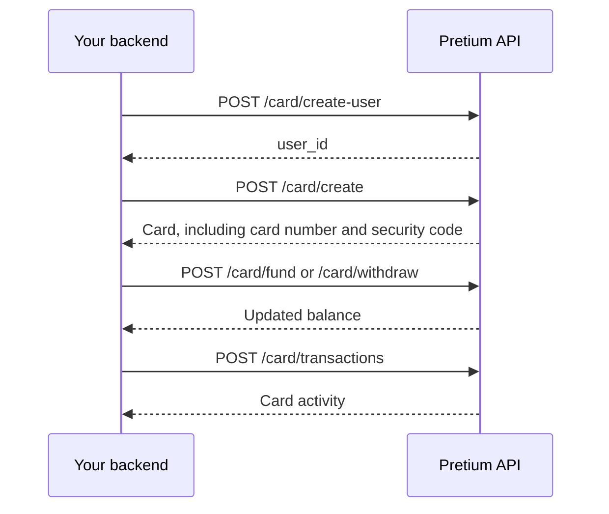

The card API issues a USD virtual Visa or Mastercard for a cardholder you register. Authenticate with your partner **consumer key** (`x-api-key`). Every endpoint is `POST` with a JSON body under `/card`.

When the card product is turned off, each call returns `400` with `Service temporarily unavailable!`.

## Flow

1. [Create a card user](/api-reference/cards/create-user). Keep the returned `user_id`.
2. [Create a card](/api-reference/cards/create) for that user. The opening `amount` is loaded onto the card in USD and must be greater than `0.9`.
3. [Read the card](/api-reference/cards/get), [fund](/api-reference/cards/fund) it, or [withdraw](/api-reference/cards/withdraw).
4. [List transactions](/api-reference/cards/transactions). [Freeze](/api-reference/cards/freeze) and [unfreeze](/api-reference/cards/unfreeze) when you need to block spending.

A card user can hold one card. A second create returns `Card user already has a card.`

## Identifying a card

Later calls use the `user_id` from create-user (your cardholder id). They do not take a separate card id, except [terminate](/api-reference/cards/terminate), which takes `card_id`.

`user_id` is scoped to your partner account. Another partner's id returns `Card user not found.`

## Card object

Create, list, and get return this object. Fund, withdraw, freeze, and unfreeze return the same fields except `card_number` and `security_code`.

| Field | Description |
|-------|-------------|
| `user_id` | Cardholder id from create-user |
| `title` | Display title |
| `color` | `blue`, `black`, `purple`, `orange`, or `yellow` |
| `name` | Name printed for the cardholder |
| `brand` | `visa` or `mastercard` |
| `currency` | `USD` |
| `balance` | Available balance as a two-decimal string |
| `status` | `active`, `frozen`, `terminating`, or `terminated` |
| `mask` | Masked card number |
| `last4` | Last four digits |
| `expiration` | Expiry from the issuer |
| `is_non_subscription` | Whether the card was issued as a non-subscription card |
| `is_contactless_payment` | Contactless flag reported for the card |
| `is_physical` | `true`, `false`, or `null` |
| `billing_address` | `address`, `city`, `state`, `zip_code`, `country`, or `null` |
| `last_used_on` | Last use time, or `null` |
| `created_at`, `updated_at` | Timestamps |
| `card_number` | Full card number. Present on create, list, and get |
| `security_code` | Security code. Present on create, list, and get |
| `total_card_spend` | Present on [get card](/api-reference/cards/get) only |

<Note>
  `POST /card/create`, `POST /card/all`, and `POST /card/get-card` return the full card number and security code. Store them as cardholder secrets. List-users nests cards without those fields.
</Note>

## Card user object

[Create](/api-reference/cards/create-user) and [edit](/api-reference/cards/edit-user) return:

| Field | Description |
|-------|-------------|
| `user_id` | Id to send on card calls |
| `email` | Cardholder email |
| `name` | `first_name` and `last_name` joined |

[List users](/api-reference/cards/users) adds `phone`, `country`, `state`, `city`, `address`, `zip_code`, and a `cards` array. ID type and ID number are not returned.

## Statuses

| Status | Meaning |
|--------|---------|
| `active` | Card can be funded, withdrawn, and spent |
| `frozen` | Spending is blocked until you unfreeze |
| `terminating` | Termination is in progress |
| `terminated` | Card is closed |

Get, fund, withdraw, freeze, and unfreeze only resolve a card that is not `terminated` or `terminating`. Transaction history still resolves a closed card.

## Amounts

Cards are issued in **USD**.

| Call | Rule |
|------|------|
| Create | `amount` must be greater than `0.9` |
| Withdraw | `amount` must be greater than `0.9` |
| Fund | `amount` is a required number |

A withdrawal the card cannot cover returns `Card has insufficient balance.`
